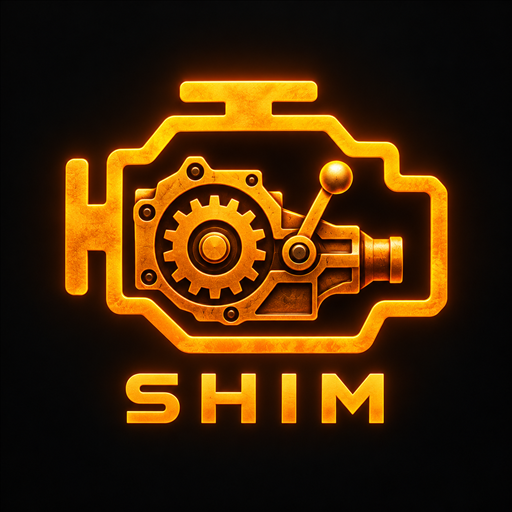

<div align="center">
  
</div>

# Shim

[](https://github.com/Rephl3x/Shim/actions/workflows/build.yml)

**Shim is a Windows controller aggregator and force-feedback adapter for Forza Motorsport and Forza Horizon.** It combines a MOZA wheel, pedals, shifters, handbrake and other selected controls into one vJoy virtual wheel, then forwards the game's force feedback to the physical steering wheel.

The bridge reads physical controls through DirectInput, maps them to a configurable virtual controller and uses HidHide to keep the selected physical devices out of the game's controller list while the bridge runs. Forza binds the virtual wheel once in a custom profile. This avoids relying on the order in which several physical controllers happen to enumerate.

## Current capabilities

- A six-step setup wizard detects devices, lets you choose control roles, and guides input learning and calibration.
- The final Save step configures the chosen vJoy slot, verifies its layout, then saves the profile. It does not overwrite other vJoy slots.
- Live input monitoring and editable mappings help diagnose and tune a rig before driving.
- Game force feedback is forwarded from the virtual controller to the selected physical wheel. Gain can be adjusted while the bridge is running without resetting the connection or effects.
- HidHide visibility recovery restores selected physical devices when the bridge stops or recovers from an interrupted session.
- Day and Night appearance modes, a Drive dashboard, driver status and activity logs are included.
- The Help page builds a user-reviewed support report with CPU, memory, GPU, graphics and wheel/controller driver versions, controller capabilities, limited FFB settings, bridge state, and recent diagnostics. It excludes mappings, calibration and Forza account data. Users can keep it locally, open an email draft addressed to themselves, or explicitly submit it privately to Shim support; uploads expire after 30 days.
- Open **Help & reports** at the bottom of the sidebar. **Create / submit report** is near the top of that page; Shim asks you to review the report and choose whether to upload it.
- Shim's check-engine transmission graphic and black-and-orange accent palette carry through the main app and first-run setup; Day and Night modes remain available.
- Start Forza from the Drive screen, with an option to start the bridge and wait until it is ready before opening the game.
- An Updates page checks Shim, vJoy and HidHide against their latest GitHub releases. Shim updates apply and restart in place; driver downloads are signature-checked and installed through Windows' administrator prompt.

## Download and setup

The latest published build is [Shim v0.8.0](https://github.com/Rephl3x/Shim/releases/tag/v0.8.0). Its Windows installer and portable ZIP are grouped locally in `dist/latest`; this folder is the single place to retrieve the newest local distribution. Previous generated builds are preserved in `archive` and are not active release files. The setup installs Shim and any missing vJoy/HidHide drivers, detects and upgrades an existing Shim installation, and lets users preserve or reset settings with a timestamped backup. Shim migrates only explicitly supported config versions and backs up files before migration. The support receiver runs on a Cloudflare Worker at `dev.amslabs.net`, stores reports privately for 30 days, and provides an Access-protected report portal at `https://dev.amslabs.net/admin`.

Windows 10/11 x64 with .NET Framework 4.8 or later is required; .NET Framework 4.8.1 is recommended where available. vJoy and HidHide are included for one-time installation; the wizard checks their status and explains when a restart or repair is needed. For the full first-run guide, controls, troubleshooting and safety details, see [the bridge guide](bridge/README.md).

After setup, use **Start Forza** on Drive to launch the game. Enable **Start bridge when I click Start Forza** under Options for a one-click bridge-and-game startup. Create a custom wheel profile in Forza and bind it to the virtual controller. The app does not inject into the game, patch game files or change USB device order.

## Build from source

The source uses the Windows .NET Framework C# compiler and does not require NuGet packages. `PackageBridge.ps1` fetches pinned official driver packages, verifies their signatures and hashes, builds the app and creates a portable ZIP. `BuildInstaller.ps1` runs that packaging step and creates the setup executable from the same payload. Build intermediates go in `build`; distributable files go in `dist/latest`. Run from Windows PowerShell:

```powershell
.\BuildInstaller.ps1 -SkipTests
```

